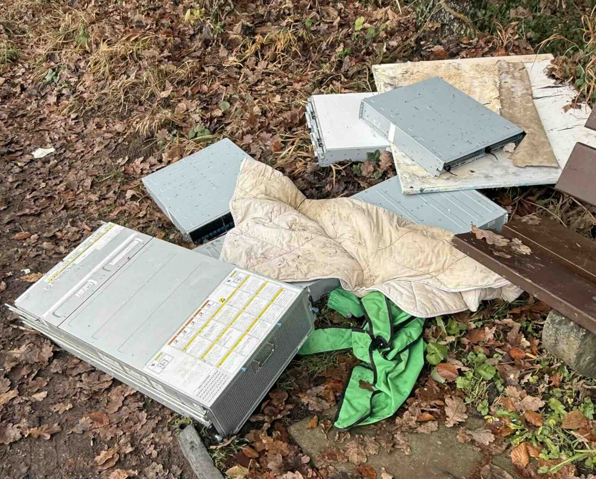

# Sketchy VSP

Scripts to reformat and unlock hard disks from a Hitachi VSP storage array found dumped in the woods with all its disks still inside.

## Why?

Disks pulled from a Hitachi VSP systems are not usable in your everyday server usually :(

This is because of two reasons :

- **Odd sector sizes:** They are formatted with 520/528 byte sectors and often have T10 protection information (DIF) enabled, so they show up as unreadable or corrupted.
- **Write lock:** Hitachi wants to feel extra fucking special and make life for us all hell hence why these drives firmware only accepts `WRITE AND VERIFY`, rejecting the normal SCSI writes with `Hardware Error` (ASC `0x81`), even after a reformat to 512 byte sectors.

## What's in here

| Script                   | What it does                                                                                                                                                 |
|--------------------------|--------------------------------------------------------------------------------------------------------------------------------------------------------------|
| [sgfmt.py](sgfmt.py)     | TUI that lists SCSI disks with their block size and protection state, then low level formats the selected ones to 512 byte sectors with protection off       |
| [sdmagic.py](sdmagic.py) | TUI that finds VSP drives, shows if their locked, then clears selected ones write lock by setting bit 0 of byte `0x14` in mode page `0x38` (using `sdparm`). |
| [smarties.py](smarties.py) | TUI that saves `smartctl -a` snapshots of the VSP drives (first one = baseline, never overwritten) and shows the live SMART counters next to what changed since the baseline, so you can tell if the formatting/unlocking made a drive worse. |

## Requirements

### Hardware

- A RAID Card that give raw device access, Examples I know work :
  - Broadcom Cards Flashed with so-called "IT Mode" (Tested on : Dell PERC H310)
  - Most PCIe HP PXXX Cards in HBA Mode (Tested on : HP P222 and P408e-p)
- A way to connect your SAS Drives to the RAID card, the following I've had success with
  - SAS Breakout Cable
  - SAS Backplane in your Server
  - SAS Drive Chassis (HP StorageWorks 3.5inch)

### Software
- Linux, root access, Python 3.7+
- `sg3-utils` and `util-linux` (`lsblk`) for both scripts
- `sdparm` for `sdmagic.py`
- `smartmontools` (`smartctl`) for `smarties.py`

### Mind

- Patience ... alot of patience

## Usage

All commands require being ran as root, `sudo su` before running em!

Run them in order:

1. `python3 smarties.py` save SMART baseline of every VSP drive it sees that arent formatting right now because well reset some of it when formatting
2. `python3 sgfmt.py` reformats selected drives to 512 byte sectors
3. `python3 sdmagic.py` tries tp remove the VSP write restriction from selected drives and tests if it worked.
4. `python3 smarties.py` check if your drives condition worsened or "improved" after formatting (format will have caused a check over the whole platter)

Notes:

- **Formatting erases everything** (on the selected disks) make sure you dont format your boot drive or something on accident lol
- Formats run inside the drive firmware and can take from hours up to a day in some cases
  - They survive quitting the script or a dead tmux session
  - Start `sgfmt.py` again and it picks up running formats, including ones you started by hand
- Formats are logged to `/var/tmp/sgfmt-sgN.log`, and the script keeps its state in `/var/tmp/sgfmt-state.json`
- Drives must be reformatted (512 or 4096 bytes, protection off) before `sdmagic.py` will unlock them
- `smarties.py` keeps its raw `smartctl` dumps and a greppable `summary.txt` in `smarties-data/` next to the script (one folder per drive serial, oldest file = baseline)
